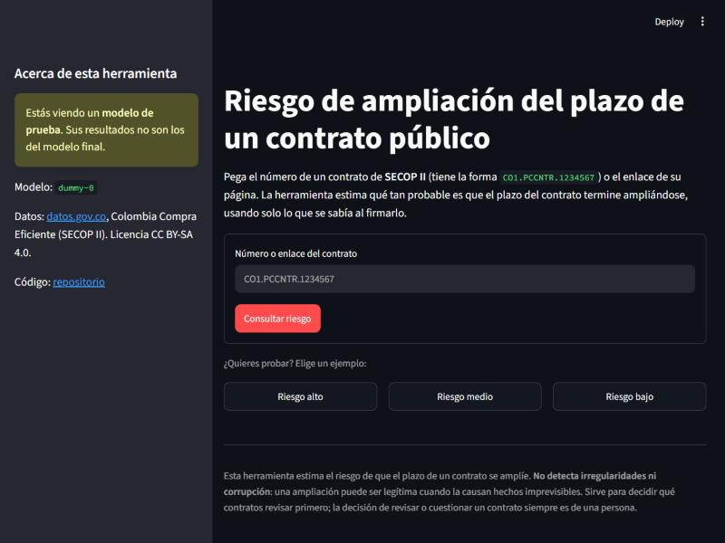
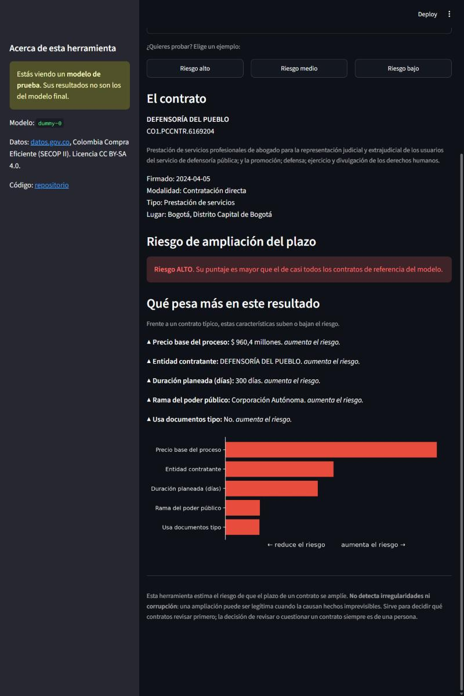

# Despliegue de la app de consulta (G2)

> Leyenda: **[VERIFICADO]** visto en el código, los datos o la documentación oficial · **[SUPUESTO]** · **[ESTIMADO]** · **[NO EVALUADO]**.
> Estado al 26 de octubre de 2026: la app funciona en local con el modelo dummy y con contratos reales de datos.gov.co. **Falta publicarla en Streamlit Community Cloud**, un paso que hace Gerónimo con su cuenta de GitHub (sección 4).

## 1. Decisión: dónde se despliega

- **Decisión:** Streamlit Community Cloud, con la app en `final-project/app/app.py`.
- **Alternativas consideradas:** Hugging Face Spaces (CPU básico) y Render (plan gratuito). Como plan C, correr `streamlit run` en local.
- **Por qué:**
  - Despliega desde el mismo repositorio público, se redespliega en cada `push` y todo es Python, sin copiar archivos a otro repositorio.
  - La RAM que necesita la app (290 MB, ver abajo) cabe con holgura en el mínimo que la plataforma ofrece (690 MB).
  - Hugging Face Spaces exige un repositorio aparte que hay que mantener sincronizado, y Render gratuito ofrece unos 512 MB [SUPUESTO, no verificado en esta tarea], demasiado justo para `shap` y `scikit-learn`.
- **Evidencia:**

| Dato | Valor | Estado |
|---|---|---|
| Memoria por app en Community Cloud | mínimo 690 MB, máximo 2,7 GB | [VERIFICADO] en la documentación oficial; son límites aproximados a febrero de 2024 y "pueden cambiar sin aviso" |
| CPU por app | de 0,078 a 2 núcleos | [VERIFICADO], misma fuente |
| Apps sin tráfico | se duermen a las 12 horas; cualquier persona con acceso puede despertarlas | [VERIFICADO] |
| Dónde se pega el token | campo "Secrets" de "Advanced settings", en formato TOML | [VERIFICADO] |
| Versión de Python | se elige en "Advanced settings" al desplegar y no se puede cambiar después sin borrar y redesplegar | [VERIFICADO] |
| `requirements.txt` | se busca primero en la carpeta del archivo principal (`final-project/app/`) | [VERIFICADO] |

**RAM medida de la app** [VERIFICADO; Python 3.14 en Windows, proceso limpio, modelo dummy]:

| Etapa | RAM |
|---|---|
| Proceso solo | 18 MB |
| Tras importar streamlit, shap, scikit-learn, pandas y matplotlib | 238 MB |
| Con el modelo y el explicador SHAP cargados | 243 MB |
| Tras 3 consultas con su gráfico (**versión desplegada**) | **290 MB** |
| Si además se cargara la base completa como respaldo (452.494 contratos) | 1.019 MB |

Por eso el respaldo local **no carga la base**: busca el contrato por lotes de 20.000 filas en el parquet (peor caso 0,22 s) y la nube, que no tiene `data/`, no lo usa: responde desde un archivo de demostración de 40 contratos (sección 7).

## 2. Arquitectura y flujo

```
Usuario ──pega el número o el enlace del contrato──> app/app.py (Streamlit)
   │                                                      │
   │                                          src/api_secop.py: extrae CO1.PCCNTR.n
   │                                                      │
   │          datos.gov.co (1 petición/s, solo rutas permitidas, solo columnas de entrada)
   │              Contratos (jbjy-vk9h)  +  Procesos (p6dx-8zbt)
   │                                                      │
   │              uniones.elegir_proceso → unir_contrato_proceso → features.construir_features
   │                      (las mismas funciones del entrenamiento, no una copia)
   │                                                      │
   │      models/modelo_prorroga_v1.joblib (o el dummy)  → puntaje → nivel y percentil
   │                                                      │
   └──<── nivel de riesgo, percentil, 5 factores en lenguaje claro (SHAP) y avisos
            Si la API falla y hay copia local, responde desde ahí y lo avisa.
```

- **Qué ingresa el usuario:** solo el número del contrato (`CO1.PCCNTR.n`) o el enlace de su página. [VERIFICADO con los metadatos del dataset: `id_contrato` es "el identificador del contrato firmado, generado por la plataforma"; la referencia del contrato la genera cada entidad y no es única, y `CO1.BDOS.n` identifica el proceso. Si se pega un número de proceso, la app lo explica.]
- **Qué no entra:** la app pide a la API **solo** las columnas de entrada de `construir_features`. Las de fuga (estado, fecha de fin, valor, pagos) y las de datos personales no se solicitan, así que no llegan aunque el portal las tenga actualizadas. Una prueba lo verifica.
- **Fechas con hora:** desde la republicación del 26 de octubre la API devuelve las fechas con hora. `construir_features` las trunca al día, igual que en la base de entrenamiento; con 21 contratos reales (819 celdas) no hubo ninguna diferencia entre la API y la base (`resultados/paridad_api_base.md`).
- **Qué muestra:** nivel de riesgo y percentil, no la probabilidad cruda (con la deriva queda descalibrada), más los 5 factores que más pesan y las aclaraciones del apartado 8 de `docs/01_definicion_problema.md`.

| Inicio | Resultado (contrato real, modelo de prueba) |
|---|---|
|  |  |

## 3. Qué hay en el repositorio para desplegar

- `app/app.py`: la interfaz. Elige `models/modelo_prorroga_v1.joblib` si existe y, si no, el dummy, y avisa cuando se usa el de prueba.
- `app/requirements.txt`: las dependencias de la app, con las mismas versiones fijas del entrenamiento. Se instaló desde cero en un entorno nuevo y la app pasó las pruebas con solo esas librerías.
- `models/` y `src/`: el artefacto y el código que la app importa. `data/` no se versiona y la nube no lo necesita.

## 4. Pasos para publicarla (los hace Gerónimo con su cuenta)

1. Entrar a [share.streamlit.io](https://share.streamlit.io) con la cuenta de GitHub que tiene acceso al repositorio `kepabonsaeafit/fundamentos-aa-2026` [SUPUESTO: se necesita permiso de escritura sobre el repositorio para conectarlo].
2. **Create app** con estos datos:
   - Repository: `kepabonsaeafit/fundamentos-aa-2026`
   - Branch: `master` cuando se hayan aprobado y fusionado los PRs; mientras tanto, `feat/despliegue`.
   - Main file path: `final-project/app/app.py`
3. En **Advanced settings**:
   - **Python version: 3.12**, la del plan. No se puede cambiar después sin borrar la app y desplegarla de nuevo [VERIFICADO]. Las pruebas locales se hicieron con 3.14, no con 3.12 [NO EVALUADO en 3.12; hay que revisar el log de construcción de la nube].
   - **Secrets** (opcional): si Kevin entrega el App Token, pegar `SOCRATA_APP_TOKEN = "..."`. Sin token la API responde igual, con menos cupo. El token nunca va en el repositorio ni en el chat.
4. **Deploy** y esperar la construcción. Con la URL pública, avisar a Kevin para el README y usarla en el video.
5. Revisar con otro equipo o desde el celular:
   - los tres ejemplos de la pantalla (riesgo alto, medio y bajo);
   - pegar un enlace de SECOP II con un `CO1.PCCNTR`;
   - un texto inválido y un contrato que no existe, que deben dar un mensaje claro y no un error.

## 5. Cambiar al modelo v1 (jueves 29)

Copiar `modelo_prorroga_v1.joblib` y su `.json` a `models/` y hacer `push`: la app prefiere ese modelo y la nube se redespliega sola [VERIFICADO: la plataforma actualiza al recibir cambios del repositorio, con un máximo de 5 por minuto]. Comprobar que la barra lateral dice `v1` y ya no muestra el aviso de modelo de prueba. `cargar_modelo` se niega a usar un artefacto con otra versión de features, otra versión de scikit-learn o un sha256 distinto.

## 6. Plan C: correr en local (sustentación)

Desde `final-project/`, con el entorno virtual del proyecto activo y la base v1 en `data/processed/v1_A/` (`config.BASE_V1`; en `data/processed/` suele estar la base vieja v0):

```
streamlit run app/app.py
```

Si datos.gov.co no responde, la app responde desde la copia local para los contratos que estén en la base y lo avisa en pantalla. Conviene tener abierta una consulta ya hecha antes de empezar.

## 7. Decisiones pendientes para el equipo

- **Respaldo en la nube.** La nube no tiene `data/`, así que si la API cae o la rechaza durante la demo desplegada la app responde desde `app/respaldo_demo.parquet`: 40 contratos de la base v1 (los 3 ejemplos de la pantalla, 35 al azar con semilla 42, 5 por año de firma de 2019 a 2025, y 2 sin proceso asociado), solo con las columnas de `COLS_RESPALDO` y 39 KB. Son datos públicos y no incluyen columnas de datos personales ni de fuga; una prueba lo verifica. Un contrato que no esté en el archivo da el mensaje claro de siempre. **Las reglas dicen que los datos no se versionan**: el archivo se agregó a pedido de Gerónimo y queda para que Kevin lo apruebe o lo retire en la revisión del PR; sin él, la app funciona igual y solo pierde este respaldo.
- **Aviso de "entidad sin historial".** Está implementado, pero se activa solo cuando el `.json` del modelo trae la lista `entidades_vistas` (los NIT con contratos en el entrenamiento). El dummy no la trae. Hay que pedirle a Jose que el modelo v1 la guarde.
- **Despertar la app.** Si pasan 12 horas sin visitas se duerme. Entrar a la URL antes del video, del ensayo del lunes 2 y de la sustentación del martes 3.

## 8. Riesgos

| Riesgo | Mitigación |
|---|---|
| La app está dormida en la demo | Despertarla antes; plan C local |
| La API de datos.gov.co no responde o rechaza la consulta (error 400) | Mensaje claro y sin traceback; respaldo local en el plan C o archivo de demostración en la nube; caché de 1 hora por contrato |
| Versión de Python distinta a la probada | Revisar el log de la primera construcción; las versiones de las librerías están fijas |
| Los límites de la plataforma cambian | La app usa unos 290 MB; el mínimo documentado es 690 MB |
| Se filtra un token | Va solo en los secretos de la plataforma o en `.env`, ambos fuera del repositorio |

## Fuentes

- [Límites de recursos y apps dormidas](https://docs.streamlit.io/deploy/streamlit-community-cloud/manage-your-app) (Streamlit Docs)
- [Dependencias de la app](https://docs.streamlit.io/deploy/streamlit-community-cloud/deploy-your-app/app-dependencies) (Streamlit Docs)
- [Gestión de secretos](https://docs.streamlit.io/deploy/streamlit-community-cloud/deploy-your-app/secrets-management) (Streamlit Docs)
- [Actualizar la versión de Python](https://docs.streamlit.io/deploy/streamlit-community-cloud/manage-your-app/upgrade-python) (Streamlit Docs)
- [Estado y limitaciones de Community Cloud](https://docs.streamlit.io/deploy/streamlit-community-cloud/status) (Streamlit Docs)
